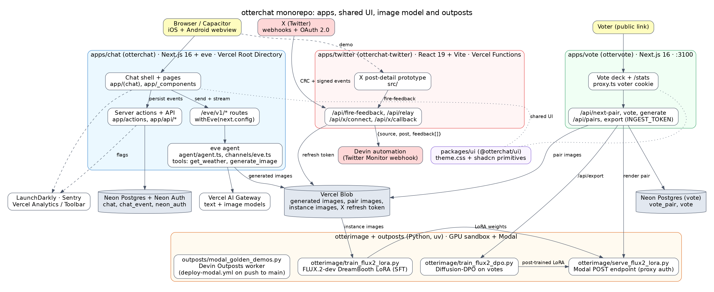

# otterchat

pnpm workspace monorepo for otterchat.

| Package | Path | Stack | Description |
| --- | --- | --- | --- |
| `otterchat` | `apps/chat` | Next.js 16 + [eve](https://eve.dev), Capacitor iOS/Android | The chat app. This is what deploys to Vercel. |
| `otterchat-twitter` | `apps/twitter` | React 19 + Vite, Vercel Functions | X (Twitter) post-detail prototype for the otterchat account, plus the X relay and OAuth connect functions that forward posts to the Devin automation webhook. |
| `ottervote` | `apps/vote` | Next.js 16 | Human-preference voting on otterimage pairs, with its own Neon database. Exports preferences for DPO training. |
| `@otterchat/ui` | `packages/ui` | Tailwind tokens + shadcn | Shared `theme.css` design tokens and UI primitives used by `apps/chat` and `apps/vote`. |

Python code shares one uv project at the root (`pyproject.toml`, `uv.lock`):

| Path | Description |
| --- | --- |
| `otterimage/` | FLUX.2-dev LoRA training (`train_flux2_lora.py`, `train_flux2_dpo.py`) and the Modal inference endpoint (`serve_flux2_lora.py`) that `apps/vote` calls. |
| `outposts/` | Devin Outposts golden-demo worker on Modal, deployed by `.github/workflows/deploy-modal.yml` on pushes to `main`. |

## Architecture

[`docs/architecture.md`](docs/architecture.md) maps how the packages fit together.
The diagram is Graphviz: edit [`docs/diagrams/architecture.dot`](docs/diagrams/architecture.dot)
and run `docs/diagrams/render.sh` to refresh the [SVG](docs/diagrams/architecture.svg) and
[PNG](docs/diagrams/architecture.png).



## Getting started

Requires Node 24+ (eve's dev server refuses to start on older Node; vite's
rolldown bindings need `^20.19 || >=22.12`) and pnpm 10.

```bash
pnpm install          # installs every workspace package

pnpm dev              # chat app        → http://localhost:3000
pnpm dev:twitter      # twitter prototype → http://localhost:5173
pnpm --filter ottervote dev  # vote app → http://localhost:3100

pnpm build            # build the chat app (what Vercel runs)
pnpm build:all        # build every package
pnpm typecheck        # typecheck every package
pnpm lint             # lint every package
pnpm --filter otterchat test  # chat unit tests
```

Anything specific to one app can be run through a filter, or from inside its
directory:

```bash
pnpm --filter otterchat-twitter build
cd apps/chat && pnpm dev
```

The chat app's `db:*`, `ios*`, and `android*` scripts are also exposed at the
root and forward to `apps/chat`.

## Per-app docs

- Chat app: [`apps/chat/README.md`](apps/chat/README.md), plus
  [setup and deployment](apps/chat/docs/setup-and-deploy.md) and
  [how the chatbot works](apps/chat/docs/how-the-chatbot-works.md). The
  provisioning script lives at `apps/chat/scripts/setup.sh` and must be run from
  `apps/chat` (it links the Vercel project to that directory).
- Twitter prototype: [`apps/twitter/README.md`](apps/twitter/README.md).
- Vote app: [`apps/vote/README.md`](apps/vote/README.md).

## Deployment

The Vercel project must have its **Root Directory** set to `apps/chat`
(Settings → Build & Deployment → Root Directory), with "Include files outside
the Root Directory" left enabled so the workspace lockfile is used. Vercel then
detects Next.js and builds the chat app as before.

A root `vercel.json` cannot substitute for this: framework detection reads the
package.json of the root directory, and the workspace root has no `next`
dependency.
