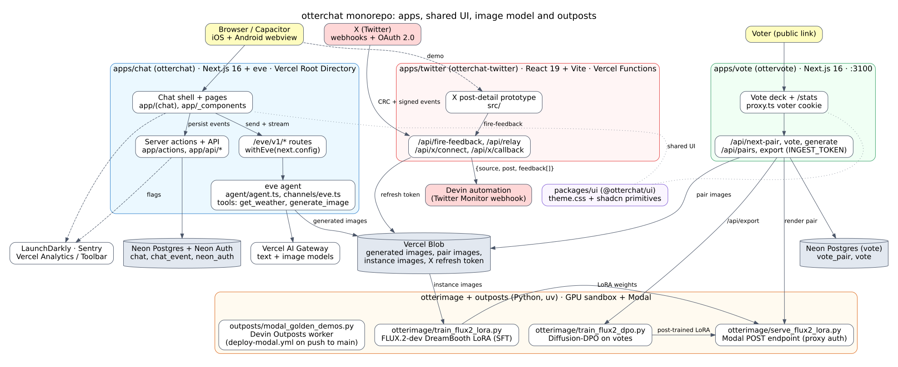

# otterchat architecture

This is the map of the whole monorepo on `main`: what each workspace package
does, how they talk to each other, and where state lives. Per-app detail lives
in each app's README; the chat runtime is covered end to end in
[how the chatbot works](../apps/chat/docs/how-the-chatbot-works.md).

The diagram source is [`diagrams/architecture.dot`](diagrams/architecture.dot)
(Graphviz). Edit it, then run `docs/diagrams/render.sh` to regenerate
[`architecture.svg`](diagrams/architecture.svg) and
[`architecture.png`](diagrams/architecture.png). Rendering needs Graphviz
(`apt-get install graphviz fonts-dejavu` or `brew install graphviz`).

## Layout

| Path | Package / runtime | What it is |
| --- | --- | --- |
| `apps/chat` | `otterchat` · Next.js 16 + eve, Capacitor iOS/Android | The chat app. The only thing the main Vercel project builds (Root Directory `apps/chat`). |
| `apps/twitter` | `otterchat-twitter` · React 19 + Vite + Vercel Functions | X (Twitter) post-detail prototype plus the X relay and OAuth connect functions that feed the Devin "Twitter Monitor" automation. |
| `apps/vote` | `ottervote` · Next.js 16, port 3100 | Human-preference voting for otterimage pairs. Own Neon database. |
| `packages/ui` | `@otterchat/ui` | Shared design tokens (`theme.css`) and shadcn primitives used by `apps/chat` and `apps/vote`. |
| `otterimage/` | Python (GPU sandbox + Modal) | FLUX.2-dev LoRA training (SFT and DPO) and the Modal inference endpoint `apps/vote` calls. |
| `outposts/` | Python on Modal | Devin Outposts golden-demo worker image and its display wrapper. |
| `src/otterchat/`, `pyproject.toml`, `uv.lock` | Python (uv) | Python project root for the Modal code. `src/otterchat` is only a placeholder `main()`. |
| `.github/workflows/deploy-modal.yml` | GitHub Actions | Runs `modal deploy outposts/modal_golden_demos.py` on pushes to `main` that touch `outposts/**`, `otterimage/requirements.txt`, the Python project files or the workflow. |

Node packages share one pnpm workspace and lockfile (`pnpm-workspace.yaml`
lists `apps/*` and `packages/*`). Python code shares one uv project at the root.

## apps/chat

A Next.js 16 app wrapped with `withEve(nextConfig)`, which mounts the eve
runtime at same-origin `/eve/v1/*`. The browser talks to eve with
`useEveAgent()` and persists the event stream through server actions.

- **Agent**: `agent/agent.ts` picks the text model per message from the
  `otterchatTextModel` auth attribute; tools are `get_weather` and
  `generate_image` (`agent/tools/`).
- **Channel**: `agent/channels/eve.ts` accepts Neon Auth users, anonymous
  first-chat visitors (`eve_anon_session` cookie), Vercel OIDC and the local
  development identity. It copies the `x-otterchat-text-model` and
  `x-otterchat-image-model` headers into auth attributes and accepts PNG, JPEG,
  WebP, GIF and PDF uploads up to 8 MB.
- **Models**: text and image models go through Vercel AI Gateway
  (`lib/models.ts`); the user's picks are kept in localStorage.
  `generate_image` stores output in Vercel Blob when `BLOB_READ_WRITE_TOKEN` is
  set, otherwise returns data URLs.
- **Storage**: local development (`next dev` without Neon) keeps chats and eve
  cursors in localStorage. Production uses Neon Auth and Neon Postgres
  (`chat`, `chat_event`) through Drizzle; deployments without that config fail
  closed.
- **Flags and telemetry**: Vercel Flags SDK with the LaunchDarkly adapter
  (`lib/launchdarkly-flag.ts`, declarations in `lib/flags.ts`, which is empty
  on `main`; discovery at `/.well-known/vercel/flags`), Vercel Analytics and Toolbar, and
  Sentry. Sentry is on in Vercel `production` and `preview`, or anywhere
  `SENTRY_ENABLED` / `NEXT_PUBLIC_SENTRY_ENABLED` is `1` or `true`; the DSN
  comes from `NEXT_PUBLIC_SENTRY_DSN`.
- **Mobile**: Capacitor wraps the deployed site (`CAP_SERVER_URL`, default `http://localhost:3000`) in
  iOS and Android shells.

## apps/twitter

A static Vite build of an X post-detail page for the otterchat account, plus
Vercel Functions under `api/`:

| Route | Purpose |
| --- | --- |
| `POST /api/fire-feedback` | The prototype's "fire feedback" button. Forwards the post and feedback to the automation. |
| `GET /api/relay` | Answers X's CRC challenge with `X_CONSUMER_SECRET`. |
| `POST /api/relay` | Verifies `x-twitter-webhooks-signature`, accepts Account Activity or X Activity API post events, and forwards each delivery. |
| `GET /api/x/connect` | Starts X OAuth 2.0 PKCE for the monitored account. |
| `GET /api/x/callback` | Checks the account, stores the refresh token in private Vercel Blob, and creates the `post.create` and `post.reply.create` subscriptions. |

Every forward goes through `api/_devin.ts`, which posts
`{ source, post, feedback[] }` to `OTTERCHAT_TWITTER_WEBHOOK_URL` with the
`x-webhook-secret` header from `OTTERCHAT_TWITTER_WEBHOOK_SECRET`. Both URL and
secret are Vercel environment variables, never committed. The X webhook must
point at `/api/relay`, not at the automation. `VITE_DEVIN_AUTOMATION_URL` is
the optional automation link the UI shows.

## apps/vote and otterimage

The otterimage loop trains a FLUX.2-dev LoRA, collects human preferences on it
and post-trains on those preferences:

1. `otterimage/train_flux2_lora.py` launches the diffusers FLUX.2-dev
   DreamBooth LoRA trainer on a GPU sandbox (B200), configured by
   `train_config.yaml`, with the instance images read from a Vercel Blob
   folder.
2. `otterimage/serve_flux2_lora.py` deploys an authenticated Modal endpoint
   (H200, LoRA weights on the `otterimage-flux2-finetune` Modal Volume;
   `Modal-Key` / `Modal-Secret` headers) that returns an image for a prompt
   and seed.
3. `apps/vote` asks the current (`OTTERIMAGE_URL`) and optional previous
   (`OTTERIMAGE_PREVIOUS_URL`) endpoints for image pairs, uploads them to
   Vercel Blob and stores them as `vote_pair` rows. A `proxy.ts` cookie
   (`otter_voter`) identifies voters; `vote` rows record each choice.
4. `GET /api/export` (behind `INGEST_TOKEN`) exports the preferences, which
   `otterimage/train_flux2_dpo.py` uses for Diffusion-DPO post-training.

`apps/chat/lib/otterimage.ts` holds the same Modal request helper for chat,
but nothing in chat calls it yet; the chat image picker lists AI Gateway models
only.

## outposts

`outposts/modal_golden_demos.py` defines the Modal app for Devin Outposts
golden-demo workers; `outposts/devin-display-wrapper.sh` starts a virtual
display for computer-use. GitHub Actions deploys it (see the layout table).

## Commands

Run from the root with Node 24+ and pnpm 10: `pnpm install`, `pnpm build:all`,
`pnpm typecheck`, `pnpm lint`, and `pnpm --filter otterchat test`. See the
[root README](../README.md) for the full list.
